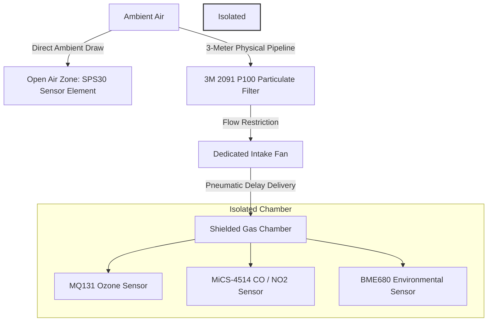
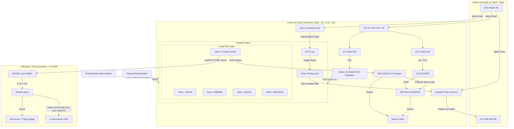
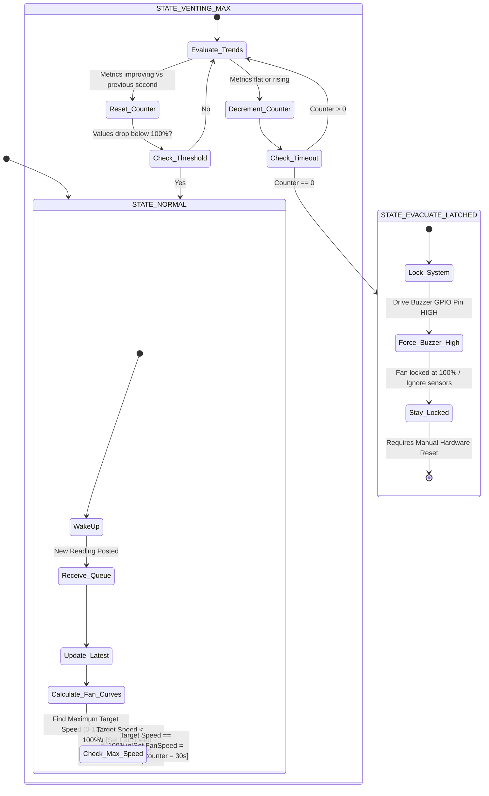
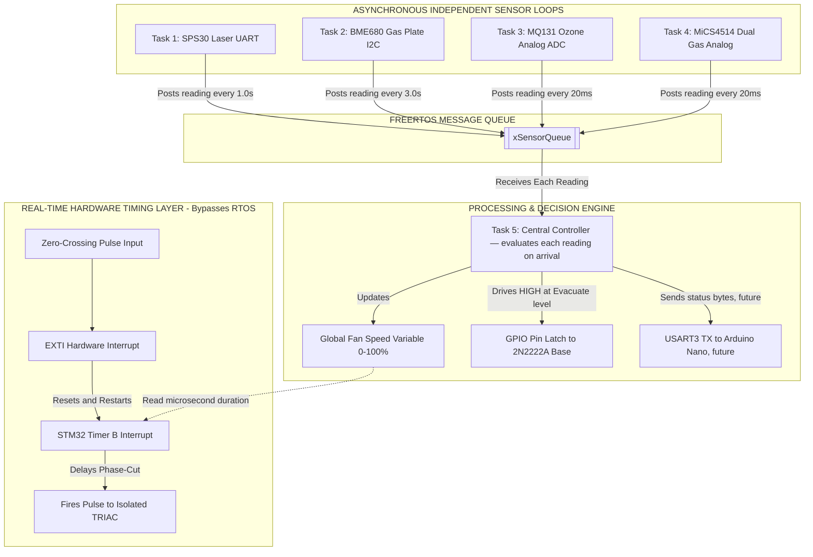
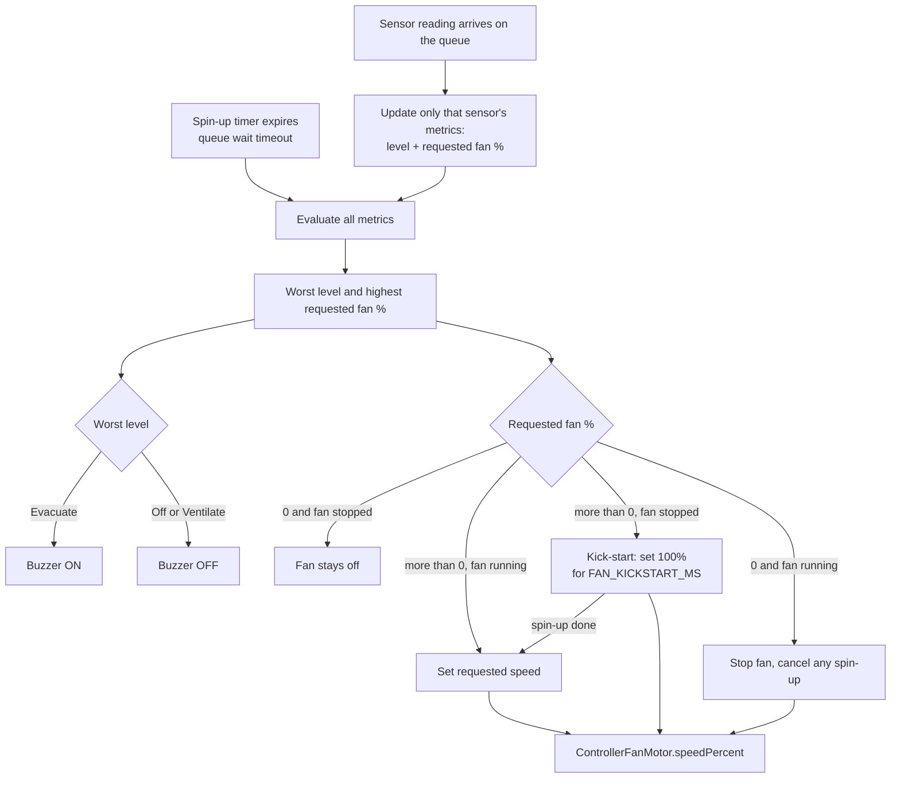
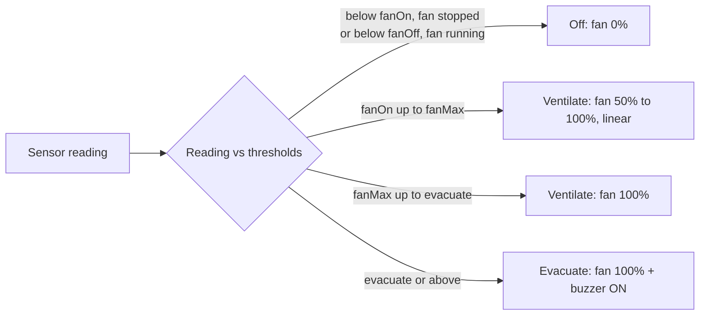

# ClearAir — Intelligent AC Vent Fan Controller

An industrial-grade, real-time environmental control and safety monitoring system running on the **STM32F4** platform. The project is designed to capture ambient air particulates and track highly toxic electrode gases generated during industrial processes (such as welding, EDM, or plasma cutting) to dynamically regulate an AC ventilation fan using a solid-state TRIAC module.

> **Migration note:** This project is planned to migrate to **STM32G4** in a future revision.

---

## 📑 Table of Contents

- [System Architecture Overview](#-system-architecture-overview)
- [Power & Logic Integration](#-power--logic-integration)
  - [Power Budget (estimate)](#power-budget-estimate)
- [Target Gases & Environmental Indices](#-target-gases--environmental-indices)
  - [Planned Control Indices](#planned-control-indices)
- [Hardware Peripheral Mapping](#️-hardware-peripheral-mapping)
- [Software Architecture](#-software-architecture)
  - [Planned Safety Latch State Machine](#planned-safety-latch-state-machine)
  - [Execution Strategy](#execution-strategy)
  - [Message-queue asynchronous flow](#message-queue-asynchronous-flow)
  - [Sensor-Level Fan Control](#sensor-level-fan-control)
- [Compensation & Normalization Models](#-compensation--normalization-models)
- [Safety Core & Fail-Safes](#-safety-core--fail-safes)
- [Roadmap](#️-roadmap)

---

## 🚀 System Architecture Overview

To protect sensitive metal-oxide gas sensors from destructive metallic dust and electrode debris while keeping ambient tracking responsive, ClearAir uses a **dual-zone sampling topology**:

*   **Ambient Air Zone:** The `SPS30` particulate matter sensor rests directly in unshielded ambient air to capture raw particulate mass values before any extraction or filtration happens.
*   **Shielded Gas Chamber:** The `MQ131`, `MiCS-4514`, and `BME680` sensors are isolated inside an analytical testing container. An intake fan pulls air through a 3-meter tube and draws it across a **3M 2091 P100 filter**. This removes 99.97% of airborne dust and metallic shards, delivering clean target gases to the metal-oxide sensor elements.

---

## ⚡ Power & Logic Integration

*   **Mains Split & Supply Rails:** The 220VAC mains feed splits two ways: one branch goes to the RobotDyn TRIAC dimmer (fan phase control), the other to an AC-DC power supply that outputs **12V** (safety buzzer) and **5V** (STM32 Nucleo board via `E5V`, plus all sensors, the RobotDyn logic side, and the Arduino Nano). The **3.3V** rail comes from the Nucleo board's on-board regulator. The 40 mm sampling-chamber intake fan runs all the time straight from the PSU; jumper `JP1` selects its supply (1-2 = 5V, 2-3 = 12V) until the fan's rated voltage is confirmed.
*   **Electrical Noise Isolation:** The internal 5V heating elements of the gas sensors are powered directly from the external 5V supply rail rather than drawing from the MCU. This layout keeps heavy electrical switching current ripples completely away from the sensitive STM32 analog circuitry.
*   **Logic Interfacing:** The `I2C3` bus uses 4.7 kΩ pull-up resistors tied strictly to the STM32's 3.3V rail. The 5V-powered modules (MQ131, MiCS-4514, RobotDyn dimmer) send their outputs (MQ131 `AO`, MiCS-4514 `RED`/`NOX`, RobotDyn `Z-C`) through passive 1.8 kΩ (series) / 3.3 kΩ (to GND) voltage dividers, which drop a 5V signal to ~3.24V, under the 3.3V GPIO/ADC limit.
*   **Board Damage Note:** On this specific STM32F446RE board, the `I2C1` and `I2C2` peripherals are physically damaged ("fried") and unusable. `I2C3` (PA8/PC9) remains the only viable I2C peripheral. `clearair.ioc` is the source of truth for pin allocation; the USART3 link below uses `PB10` (TX) / `PC5` (RX) as allocated there.
*   **USART3 Link to Arduino (future):** A dedicated **USART3** connection will eventually bridge the STM32 to a secondary **Arduino Nano** (already in stock), running on its native 5V logic domain — kept separate from the sensor `I2C3` bus. A pair of **2N7000** MOSFETs will handle bidirectional 3.3V↔5V level shifting on the TX/RX lines between the STM32's 3.3V USART3 pins and the Arduino's 5V UART pins. The Arduino Nano will drive a future visualization stage — an LED array or 7-segment display — for per-sensor status indication, receiving status bytes over this serial link. The safety-latch buzzer stays wired directly to the STM32 (see Safety Core & Fail-Safes) so it keeps working even if the Arduino is unreachable or dead.

### Power Budget (estimate)

Typical datasheet values, not measurements (±20%). STM32 at 180 MHz (`clearair.ioc`). The future LED array / 7-segment display is **not** included; budget another 100–300 mA on 5V for it.

**5V rail**

| Load | Typical | Peak / max |
| :--- | :--- | :--- |
| NUCLEO-F446RE (MCU @ 180 MHz + ST-LINK + LEDs) | ~100 mA | 150 mA |
| 3V3 loads via Nucleo regulator (BME680 incl. gas-heater pulses, I2C pull-ups, 2N7000 pull-ups) | ~5 mA | 15 mA |
| SPS30 (measuring) | 60 mA | 80 mA |
| MQ131 heater + module | ~170 mA | 185 mA |
| MiCS-4514 (RED + OX heaters + module) | ~60 mA | 75 mA (preheat) |
| RobotDyn logic side (Z-C opto + PSM) | ~5 mA | 15 mA |
| 1.8k/3.3k dividers (×4) + 5V pull-ups R11/R13 | ~5 mA | 5 mA |
| Arduino Nano (board only) | ~25 mA | 40 mA |
| **Total, fan on 12V** | **~430 mA ≈ 2.2 W** | **~570 mA ≈ 2.9 W** |
| 40 mm fan, if 5V type | +100 mA | +200 mA |
| **Total, fan on 5V** | **~530 mA ≈ 2.7 W** | **~770 mA ≈ 3.9 W** |

**12V rail**

| Load | Typical | Peak / max |
| :--- | :--- | :--- |
| 12V buzzer (active type, only when latched on) | 30 mA | ~100 mA (loud siren type) |
| R16 gate pull-up (buzzer off, Q3 conducting) | 1.2 mA | 1.2 mA |
| **Total, fan on 5V** | **~1 mA idle / ~30 mA alarm** | **~100 mA ≈ 1.2 W** |
| 40 mm fan, if 12V type | +60 mA | +100 mA |
| **Total, fan on 12V** | **~90 mA alarm ≈ 1.1 W** | **~200 mA ≈ 2.4 W** |

**PSU sizing:** 5V ≥ 1 A (≈ 1.5 A with the future display), 12V ≥ 0.3 A, so a ~10 W dual-output module (e.g. 5V/1.5A + 12V/0.5A) is enough. The extra 5V headroom covers cold-heater inrush on the MQ131 and MiCS-4514. The gas-sensor heaters are ~60% of the 5V load. Replace the buzzer and fan rows with the real label currents once known.

---

## 📊 Target Gases & Environmental Indices

| Sensor | Target Media | Application / Electrode Coverage |
| :--- | :--- | :--- |
| **SPS30** | PM1.0, PM2.5, PM4.0, PM10 | Monitors metallic fumes, hexavalent chromium particulates, manganese dust, and airborne ash before it reaches the filters. |
| **MQ131** | Ozone ($O_3$) | Tracks $O_3$ gas generated by intense ultraviolet (UV) radiation when open electric arcs ionize ambient oxygen molecules. |
| **MiCS-4514** | Carbon Monoxide ($CO$) & Nitrogen Dioxide ($NO_2$) | Measures toxic shielding gas breakdown products, incomplete combustion ($CO$), and high-temperature thermal fixation byproducts ($NO_2$). |
| **BME680** | VOCs, Sulfur Compounds, $H_2$ Gas | Utilizes the **Bosch BSEC2 library** to track complex vapor emissions coming from cutting fluids, dielectric oils, and insulating resins. |

### Planned Control Indices

Not implemented yet. Fan control today uses per-metric thresholds with no blended index (see [Sensor-Level Fan Control](#sensor-level-fan-control)).

*   **Chamber Air Quality Index (AQI):** A multi-variable matrix blending $CO$, $NO_2$, and BSEC2 $VOC$ data into a single risk metric to determine basic ventilation speeds.
*   **Oxidizing Gas Index (OGI):** A high-priority index tracking the sum of $O_3$ and $NO_2$ gas streams, mirroring extreme electrode ionization states.
*   **Filter Loading Index (FLI):** Calculated from the delta ratio between raw outdoor $SPS30$ values and internal $BME680$ barometric pressure drops, triggering a warning when the physical filter element is clogged.

---

## 🛠️ Hardware Peripheral Mapping

The full wiring schematic (every NUCLEO-F446RE morpho pin connection) is in [`hardware/Nuclio-F466RE/clearair.kicad_sch`](hardware/Nuclio-F466RE/clearair.kicad_sch) (KiCad 10).

| Subsystem Component | Peripheral Identifier             | Physical Hardware Pin           | Hardware Mode & Execution Profile |
| :--- |:----------------------------------|:--------------------------------| :--- |
| **SPS30 + BME680** | I2C3                              | PA8 (SCL), PC9 (SDA)            | Standard Open-Drain. |
| **MQ-131 Output** | ADC1_IN0                          | PA0                             | Single-Ended Analog Input (Requires External Divider). |
| **MiCS-4514 (CO)** | ADC2_IN1                          | PA1                             | Single-Ended Analog Input ($V_{OUT1}$). |
| **MiCS-4514 ($NO_2$)** | ADC2_IN7                          | PA7                             | Single-Ended Analog Input ($V_{OUT2}$). |
| **MiCS-4514 (Preheat)** | GPIO Output                       | PC8                             | Push-Pull digital output, driven HIGH during heater warm-up (not PWM). |
| **RobotDyn ZC Input** | EXTI16                            | PC6                             | Digital Input, configured for falling-edge interrupts. The module runs on 5V, so `Z-C` reaches PC6 through a 1.8 kΩ / 3.3 kΩ divider. |
| **RobotDyn Gate Out** | GPIO Output                       | PC7                             | Push-Pull, High-Speed Output driven by Timer ISR. |
| **Phase-Delay Tracking** | TIM3                              | Internal                        | One-Pulse Hardware Mode (Triggered by ZC Interrupt). |
| **OS Kernel Clock** | SysTick                           | Internal                        | Dedicated exclusively to FreeRTOS Scheduler operations. |
| **HAL Timebase** | TIM6                              | Internal                        | Dedicated strictly to standard HAL delay and timeout loops. |
| **Debug & Telemetry** | USART2                            | PA2 (TX), PA3 (RX)              | Asynchronous communication mapped to ST-LINK VCP. |
| **Status Indicator** | GPIO Output                       | PA5                             | Mapped to onboard status LED. |
| **Arduino Visualization Controller (future)** | USART3 (via 2N7000 level shifter) | PB10 (TX), PC5 (RX)             | Future status output stage: an Arduino Nano (5V logic, already in stock) drives an LED array or 7-segment display for per-sensor nominal/fault indication, receiving status bytes over `USART3`; a pair of 2N7000 MOSFETs handle bidirectional 3.3V↔5V level shifting on the TX/RX lines. The safety-latch buzzer remains directly on the STM32, independent of the Arduino. |
| **Manual Reset (external button)** | NRST                              | NRST (exposed on morpho header) | External hardware reset button wired directly to the STM32's `NRST` pin, in parallel with the onboard Nucleo reset button. True hardware system reset; no firmware or GPIO involvement. |
| **Cold/Warm Boot Select (external button)** | GPIO Input                        | PC12                            | External momentary button wired to `PC12`. Firmware reads the pin once at boot: held down means a cold boot, otherwise warm. |

---

## 🧠 Software Architecture

The software stack runs on top of a priority-preemptive FreeRTOS kernel. It segments slower sensor processing delays from the real-time, time-critical AC phase-angle modulation routines:

### Planned Safety Latch State Machine

This is the intended design, **not what the firmware does today**. The implemented behavior is in [Sensor-Level Fan Control](#sensor-level-fan-control): there is no 30 s countdown, no latch, and the buzzer turns off again when the air improves. The latch and the manual-reset requirement are still to do.

### Execution Strategy
*   **Boot Mode Selection:** The `PC12` boot-select button must be held down at the moment the system boots. Before any sensor `configure()` call runs, `appStartDefaultTask` reads the pin once: if held, it's a cold boot; otherwise a warm boot. On a warm boot, MQ131 and MiCS-4514 run their normal (short) warm-up before publishing readings; on a cold boot, each runs its own extended warm-up/soak in parallel (see `device/o3sensor` and `device/co1no2`) — none of this is persisted across reboots. The selected mode is then sent to the Arduino Nano over the (future) `USART3` link, which lights one of two indicator LEDs to reflect the choice — the LEDs are driven by the Arduino, not directly by the STM32.
*   **Aggregate Update Cadence:** Individual sensor tasks post to the queue at their own native rate (`SPS30` every 1.0s, `BME680` every 3.0s, `MQ131`/`MiCS-4514` every 20ms), but the system as a whole pushes an updated aggregate `CollectedAirData` snapshot roughly every ~5 seconds for downstream consumers (telemetry, and the future Arduino visualization stage).
*   **Low-Overhead Data Capture:** `ADC1` runs continuously in multi-channel Scan Mode handled via DMA. It updates a local 3-element array in RAM with fresh voltages from the `MQ131` and `MiCS-4514` sensors without generating any CPU overhead.
*   **AC Phase Control Loop:** (implemented in `device/fanmotor`, it bypasses the RTOS)
    1. The AC power wave crosses zero volts and the RobotDyn zero-cross output pulls the `ZC_INPUT` pin low.
    2. The falling-edge external interrupt runs `HAL_GPIO_EXTI_Callback`, which calls `onZeroCross()`. If the fan speed is 0 it returns and the gate stays low.
    3. Otherwise it resets the `TIM3` counter, loads the current phase delay into `TIM3->ARR` and starts the `TIM3` update interrupt.
    4. When `TIM3` expires, its interrupt calls `onGateCompareMatch()`, which pulses the TRIAC gate pin (`TRIAC_DIMMER`) high for about 100 µs.
    5. `speedPercent()` (called from the control loop) sets the delay: 50% maps to a long delay (low power) and 100% to a short one, see [Sensor-Level Fan Control](#sensor-level-fan-control).

---

### Message-queue asynchronous flow

### Sensor-Level Fan Control

The control loop (`mainSensorsMsgLoop` in `Core/Src/control_center.cpp`) turns every sensor reading into a danger level and a requested fan speed. The fan follows the worst metric.

**Per metric.** Each metric (BME680 IAQ, MQ131 ozone, SPS30 PM2.5, SPS30 PM10, MiCS-4514 CO, MiCS-4514 NO2) has four thresholds, in the metric's own unit:

| Threshold | Meaning |
| :--- | :--- |
| `fanOff` | A running fan keeps running until the reading drops below this value. It sits slightly below `fanOn`, so the fan does not switch on and off when a reading hovers around the turn-on point. |
| `fanOn` | A stopped fan turns on, at the minimum speed (50%), when the reading reaches this value. |
| `fanMax` | The fan reaches 100% at this value. Between `fanOn` and `fanMax` the speed rises linearly from 50% to 100%. |
| `evacuate` | At or above this value the buzzer turns on. It is at or above `fanMax`, so the fan is already at full speed when the alarm sounds. |

These give each metric one of three danger levels:

| Level | Condition | Fan | Buzzer |
| :--- | :--- | :--- | :--- |
| `Off` | Below `fanOn` (or below `fanOff` if the fan is already running) | Off | Off |
| `Ventilate` | From `fanOn` up to `evacuate` | 50% to 100%, proportional to the reading | Off |
| `Evacuate` | At or above `evacuate` | 100% | On |

**Across metrics.** Every reading that arrives updates only its own metrics in a shared structure that holds the latest level and requested fan speed of each metric. When the loop finishes handling a message, it evaluates the whole structure: the fan speed is the highest requested by any metric, and the buzzer is on if any metric is at `Evacuate`. The fan and buzzer are only written when the result changes.

**Kick-start.** A stopped motor cannot start at 50% speed. When the fan turns on from off, it first runs at 100% for a fixed spin-up time (`FAN_KICKSTART_MS`), then drops to the requested speed. The fan has no tachometer, so this is a timer, not a measured speed. If the air becomes clean during the spin-up, the fan stops straight away. The loop waits on the queue with a timeout while a spin-up runs, so the fan drops to its target on time even if no sensor message arrives.

**Fan speed to power.** The fan speed percentage maps linearly to the TRIAC firing delay in `device/fanmotor` (50% = `TRIAC_MIN_POWER_DELAY_US`, 100% = `TRIAC_MAX_POWER_DELAY_US`). It is not a power percentage. The 8" fan is an 80 W, 220 V capacitor-run AC motor, which stalls or hums at low voltage, so the minimum delay is set to give roughly 60% of mains RMS voltage at the 50% setting. That value is an estimate from the firing-angle curve and must be confirmed on the bench.

**Current limits.** The buzzer is not latched: it turns off when every metric drops below `evacuate`, unlike the latched `STATE_EVACUATE_LATCHED` in the [planned state machine](#planned-safety-latch-state-machine) above. A metric that has not reported yet counts as `Off`, and there is no stale-data or loss-of-signal handling yet. The MQ131 thresholds are placeholders on raw ADC counts and need calibration, and the other thresholds come from public exposure limits (see the comments next to them in `control_center.cpp`).

## 📉 Compensation & Normalization Models

*   **Pneumatic Lag Tracking:** Air taking a 3-meter path through a dense P100 filter introduces a noticeable physical delay. The control software channels open-air $SPS30$ data packets into an internal software ring buffer. This matches delayed chamber sensor gas metrics with historical particulate conditions.
*   **Environmental Compensation:** Temperature, humidity, and barometric drops alter the baseline resistance ($R_0$) of metal-oxide sensors. ClearAir feeds live ambient calculation layers from the Bosch BSEC2 library into the conversion algorithms to scale raw sensor voltages ($V_{OUT}$ to PPM) relative to the physical conditions inside the chamber.

---

## 🚨 Safety Core & Fail-Safes

**Status:** none of the fail-safes below is implemented yet. The implemented safety behavior is the threshold-based fan ramp and buzzer in [Sensor-Level Fan Control](#sensor-level-fan-control).

*   **Loss of Signal Safeguard:** If the `I2C3` communication lines stall, or if the `ADC1` DMA buffer fails to cycle for 5 consecutive periods, the firmware shifts into an Emergency Override state, locking the TRIAC delay to 0% to force the exhaust fan to run continuously at 100% capacity.
*   **Electrical Fault Monitoring:** If any analog channel detects an out-of-bounds voltage (0V matching a short circuit, or 3.3V matching a ruptured line), the event is reported over telemetry and the ventilation loop steps up to full speed.
*   **Non-Volatile Baseline Recovery:** The system stores the active BSEC2 engine state data matrix to internal flash sectors every hour to prevent calibration degradation during unexpected system power losses.

---

## 🗺️ Roadmap

- [x] 1. **KiCad schematic.** ✅ **Done.** "Create" is a big word here: Claude generated it on request (`hardware/Nuclio-F466RE/clearair.kicad_sch`).
- [x] 2. **Move to a WeAct G4 Long** (STM32G474CEU6 Long + STLINK-V3MINIE).
- [x] 3. **Fan and alarm thresholds:** thresholds, fan ramp, kick-start and the evacuation buzzer trigger are implemented (see Sensor-Level Fan Control). Still to do: calibrate the MQ131 thresholds, measure the real minimum fan speed and spin-up time on the bench, latch the alarm, and add stale-data / loss-of-signal handling.
- [ ] 4. **Sensor cylinder:** design and 3D print a cylinder that holds all the sensitive sensors, downstream of a fan with a 3M 2091 particulate filter.
- [ ] 5. **Minimal field test,** with buttons that inject the fan and alarm events.
- [ ] 6. **Power + MCU enclosure:** design and build it (220V AC to 12V and 5V DC).
- [ ] 7. **Full field test** with the welder.

---

## 📌 STM32G474CEU6 Pin Plan (WeAct G4 Long)

Planned pin map for roadmap step 2: **STM32G474CEU6** (UFQFPN48) on the WeAct G4 Long board, debugged with an STLINK-V3MINIE. The new board has no damaged peripherals, so the I2C3-only limit from the F446RE board does not apply. The sensor bus moves to `I2C1`. This plan is not yet in `clear-air.ioc`. Apply it there first, then regenerate. Pin functions come from the CubeMX DB (`STM32G474C(B-C-E)Ux.xml`).

**Kept from the F446RE design:** CubeMX labels (`ZC_INPUT`, `DIMMER_LEVEL`, `MICS4514_PREHEAT`, `BOOT_TY_SELECT`), so the C++ code under `device/*` builds without edits. Peripheral instances `ADC1`/`ADC2`, `USART2`, `USART3`, `TIM3`, `TIM6` also stay the same. The I2C handle changes from `hi2c3` to `hi2c1` (`Core/Src/cpp_main.cpp`). The analog pins stay `PA0`/`PA1`/`PA7`, but the G4 channel numbers change.

### Service → Pin Assignments

| Service | Peripheral | G474 Pin (UFQFPN48 pin #) | F446RE Pin (old) | Notes |
| :--- | :--- | :--- | :--- | :--- |
| **SPS30 + BME680** | I2C1 | PA15 SCL (38), PB7 SDA (45) | PA8, PC9 (I2C3) | 4.7 kΩ pull-ups to 3.3V. `PA15` is free because debug uses SWD only (no `JTDI`). |
| **MQ-131 Output** | ADC1_IN1 | PA0 (8) | PA0 (ADC1_IN0) | Through the 1.8 kΩ / 3.3 kΩ divider. |
| **MiCS-4514 (CO)** | ADC2_IN2 | PA1 (9) | PA1 (ADC2_IN1) | `PA1` is shared by ADC1/ADC2 IN2. Select ADC2 in CubeMX. |
| **MiCS-4514 ($NO_2$)** | ADC2_IN4 | PA7 (15) | PA7 (ADC2_IN7) | Through the divider. |
| **RobotDyn ZC Input** | GPIO EXTI0 | PB0 (17) | PC6 (EXTI6) | Falling edge, pull-up, through the divider. Uses the dedicated `EXTI0_IRQn` vector (priority 5, as the old `EXTI9_5_IRQn`). |
| **RobotDyn Gate Out** | GPIO Output | PB1 (18) | PC7 | Push-pull, high speed, driven from the `TIM3` ISR. |
| **MiCS-4514 (Preheat)** | GPIO Output | PB12 (25) | PC8 | Push-pull, initial state LOW. |
| **Cold/Warm Boot Select** | GPIO Input | PB14 (27) | PC12 | Pull-up, read once at boot. |
| **Safety Buzzer Latch** | GPIO Output | PB15 (28) | — (not allocated) | New. Drives the 2N2222A base for the 12V buzzer. Initial state LOW. |
| **Status Indicator** | GPIO Output | PC6 (29) | PA5 | On-board WeAct user LED. |
| **Debug & Telemetry** | USART2 | PA2 TX (10), PA3 RX (11) | PA2, PA3 | The board has no on-board ST-LINK, and the 4-pin SWD header has no VCP lines. Wire `PA2`/`PA3` to the STLINK-V3MINIE 14-pin connector (`T_VCP_RX`/`T_VCP_TX`) or to a USB-serial adapter. |
| **Arduino Visualization Controller (future)** | USART3 (via 2N7000 level shifter) | PB10 TX (22), PB11 RX (24) | PB10, PC5 | |
| **Phase-Delay Tracking** | TIM3 | Internal | Internal | At 170 MHz SYSCLK with APB1 = HCLK, set prescaler `169` for a 1 µs tick (was `89` at 90 MHz). |
| **HAL Timebase** | TIM6 | Internal | Internal | `TIM6_DAC_IRQn`. |
| **OS Kernel Clock** | SysTick | Internal | Internal | FreeRTOS only. |
| **Manual Reset (external button)** | NRST | PG10-NRST (7) | NRST | In parallel with the on-board reset key. |

### Reserved Pins (board / debugger — do not assign)

| Pin | Used by |
| :--- | :--- |
| PA13, PA14 | SWD (`SWDIO`, `SWCLK`). The STLINK-V3MINIE connects to the board's dedicated 4-pin SWD header (3V3, SWDIO, SWCLK, GND) next to the two keys. That header has no `SWO` or `JTDI`, so `PB3` and `PA15` are free. |
| PA11, PA12 | On-board USB-C (`USB_DM`, `USB_DP`) |
| PB8-BOOT0 | BOOT0, wired to the on-board BOOT key |
| PG10-NRST | NRST, wired to the on-board reset key and the external reset button |
| PF0, PF1 | 8 MHz HSE crystal |
| PC14, PC15 | 32.768 kHz LSE crystal |
| PC6 | On-board user LED (used as the status indicator above) |
| PC13 | On-board user key |
| PB4, PB6 | UCPD1 dead-battery pull-downs (`CC2`/`CC1`). Avoided, so they stay free of side effects. |

### Conflict Check

*   Each pin above has one function.
*   The only EXTI line in use is EXTI0 (`PB0`). `PA0` (also line 0) is analog, so it does not claim EXTI0.
*   No alternate function overlaps another selected peripheral. The other I2C1 pin options are not used: `PA13`/`PA14` are SWD and `PB8` is BOOT0. `PB9` (I2C1_SDA alt) stays unused. The I2C1 SMBA pin (`PB5`) stays unused.
*   `VREF+` (pin 20) must connect to `VDDA` on the board for the ADCs to read against 3.3V.

**Spare pins after this plan:** PA4, PA5, PA6, PA8, PA9, PA10, PB2, PB3, PB5, PB9, PB13, PC4, PC10, PC11. PA4/PA5/PA6/PB2/PC4 also have ADC2 inputs, so they suit extra analog sensors.

The schematic and the power budget above still describe the NUCLEO-F446RE. Update them when this plan goes into `clear-air.ioc`.
