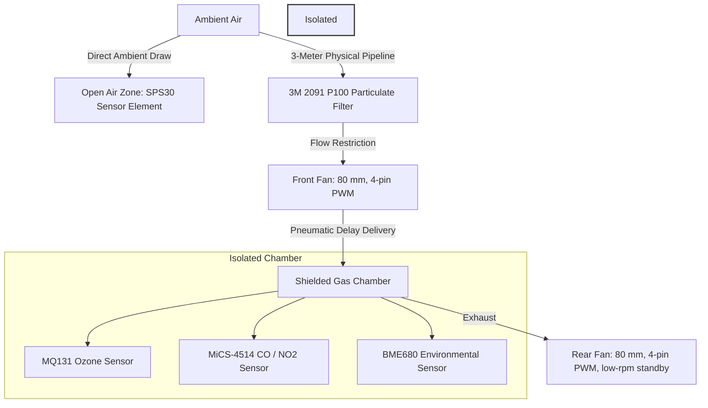
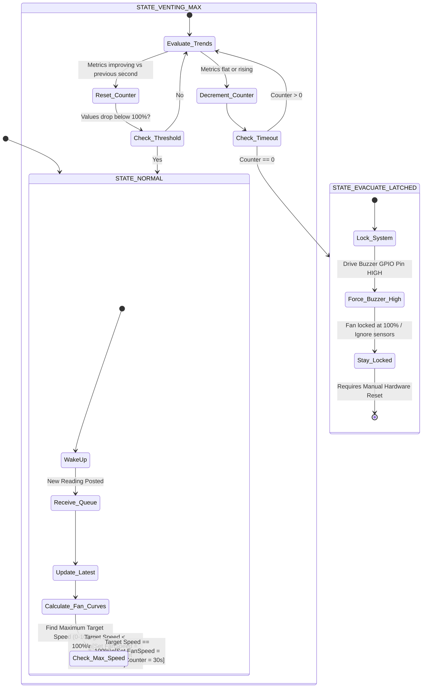
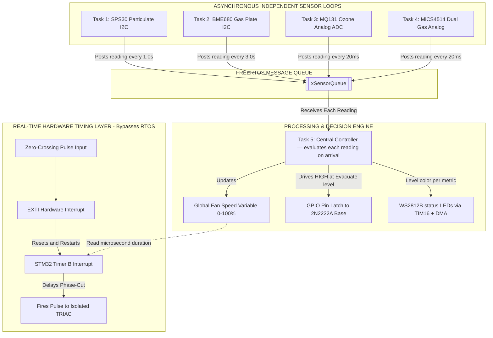
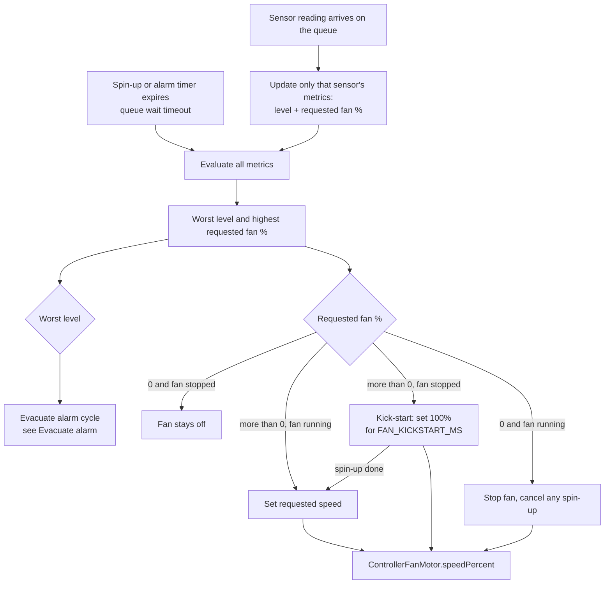
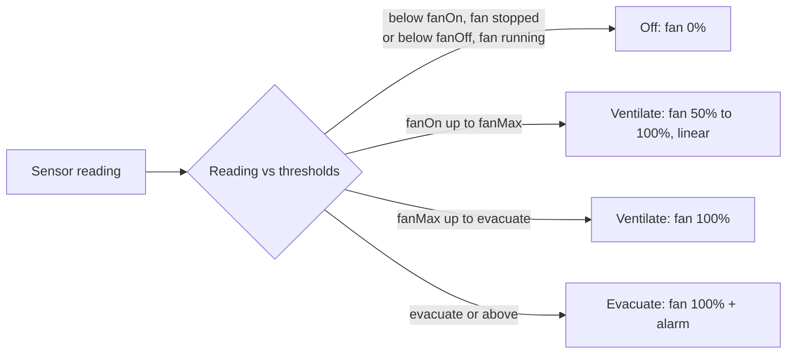
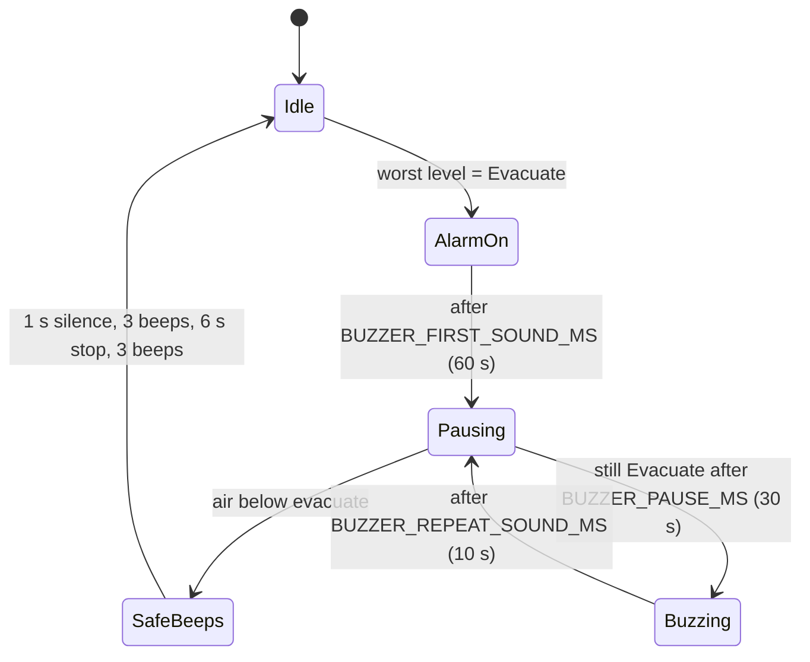

# ClearAir — Intelligent AC Vent Fan Controller

An industrial-grade, real-time environmental control and safety monitoring system running on the **STM32G4** platform. The project is designed to capture ambient air particulates and track highly toxic electrode gases generated during industrial processes (such as welding, EDM, or plasma cutting) to dynamically regulate an AC ventilation fan using a solid-state TRIAC module.

---

## 📑 Table of Contents

- [System Architecture Overview](#-system-architecture-overview)
- [Power & Logic Integration](#-power--logic-integration)
  - [Power Budget (estimate)](#power-budget-estimate)
- [Target Gases & Environmental Indices](#-target-gases--environmental-indices)
  - [Planned Control Indices](#planned-control-indices)
- [Hardware Peripheral Mapping](#️-hardware-peripheral-mapping)
- [Software Architecture](#-software-architecture)
  - [Planned Safety Latch State Machine](#planned-safety-latch-state-machine)
  - [Execution Strategy](#execution-strategy)
  - [Message-queue asynchronous flow](#message-queue-asynchronous-flow)
  - [Sensor-Level Fan Control](#sensor-level-fan-control)
  - [Evacuate alarm](#evacuate-alarm)
- [Compensation & Normalization Models](#-compensation--normalization-models)
- [Safety Core & Fail-Safes](#-safety-core--fail-safes)
- [Roadmap](#️-roadmap)
- [STM32G474CEU6 Pin Plan (WeAct G4 Long)](#-stm32g474ceu6-pin-plan-weact-g4-long)
  - [Service → Pin Assignments](#service--pin-assignments)
  - [Reserved Pins (board / debugger — do not assign)](#reserved-pins-board--debugger--do-not-assign)
  - [Conflict Check](#conflict-check)

---

## 🚀 System Architecture Overview

To protect sensitive metal-oxide gas sensors from destructive metallic dust and electrode debris while keeping ambient tracking responsive, ClearAir uses a **dual-zone sampling topology**:

*   **Ambient Air Zone:** The `SPS30` particulate matter sensor rests directly in unshielded ambient air to capture raw particulate mass values before any extraction or filtration happens.
*   **Shielded Gas Chamber:** The `MQ131`, `MiCS-4514`, and `BME680` sensors are isolated inside an analytical testing container. A front fan pulls air through a 3-meter tube and draws it across a **3M 2091 P100 filter**. This removes 99.97% of airborne dust and metallic shards, delivering clean target gases to the metal-oxide sensor elements.
*   **Fans:** Two identical 80 mm (8025), 12 V, 4-pin PWM fans (Cooler Master `FA08025M12LPA` class, about 5800 rpm at full speed, about 0.66 A each). Both run all the time: the front fan sets the sampling flow, at a speed well below its 5800 rpm maximum. The rear fan, at the exhaust end of the chamber, runs at a low speed and keeps the chamber near ambient pressure. If the front fan's tach signal shows a failure, the rear fan speeds up so air still passes through the filter and the sensors are not exposed to unfiltered air. This failover is planned and not implemented in firmware yet. Each fan has its own PWM output and tach input (see the pin plan below).

---

## ⚡ Power & Logic Integration

*   **Mains Split & Supply Rails:** The 220VAC mains feed splits two ways: one branch goes to the RobotDyn TRIAC dimmer (fan phase control), the other to two AC-DC power supply modules, each 2 A and 36.4 x 70 x 23 mm: one outputs **12V** (safety buzzer and both 80 mm fans) and one outputs **5V** (WeAct G474CE Long board via its `P3` 5V pad, plus all sensors, the RobotDyn logic side, and the front-panel WS2812B LEDs). The **3.3V** rail comes from the WeAct board's on-board regulator. Both 80 mm fans run from the 12V rail through the relay `K1` (Panasonic ALDP112, 12 V coil, 1 Form A, 3 A at 30 V DC): the relay contact feeds the fans' 12V pins (`M2` and `M3` pin 2, net `FAN_12V`), so they run whenever the relay is closed. `PB5` (`FILTER_FAN_POWER`) drives `Q6` (2N2222A) through `R41` (1 kΩ); `Q6` switches the coil to GND, `D3` (1N4148) is the flyback diode and `R44` (10 kΩ) keeps the relay open while the pin is not driven, so the fans have no power until the firmware sets `PB5` high. Each fan's PWM and tach wires go to the STM32 (see the pin plan); the fan GND is common with the STM32 GND.
*   **Electrical Noise Isolation:** The internal 5V heating elements of the gas sensors are powered directly from the external 5V supply rail rather than drawing from the MCU. This layout keeps heavy electrical switching current ripples completely away from the sensitive STM32 analog circuitry.
*   **Logic Interfacing:** The `I2C1` bus uses 4.7 kΩ pull-up resistors tied strictly to the STM32's 3.3V rail. The 5V-powered modules (MQ131, MiCS-4514, RobotDyn dimmer) send their outputs (MQ131 `AO`, MiCS-4514 `RED`/`NOX`, RobotDyn `Z-C`) through passive 1.8 kΩ (series) / 3.3 kΩ (to GND) voltage dividers, which drop a 5V signal to ~3.24V, under the 3.3V GPIO/ADC limit.
*   **Front Panel:** The STM32 drives the panel itself; there is no second controller. Six WS2812B RGB LEDs (5 V, one per metric: IAQ, O3, PM2.5, PM10, CO, NO2) form one chain on header `J9` (1 +5V, 2 DIN, 3 GND). Their data comes from `PA6` (`LED_DATA`, `TIM16_CH1` PWM fed by DMA at 800 kHz) through one gate of a 74AHCT125N (`U6`, in a DIP-14 socket, powered from 5 V), because the WS2812B needs at least 0.7 x 5 V = 3.5 V on DIN, more than a 3.3V pin gives. A 330 Ω resistor (`R25`) sits in series with DIN, `C27` (220 µF) buffers the LED supply at `J9`, and `C26` (100 nF) decouples `U6`. The three unused gates have their inputs on GND and `OE` on +5V. Each LED shows its metric's danger level by color and blinks while the buzzer alarm runs; the firmware caps the brightness. An I2C text display connects to header `J10` (1 3V3, 2 GND, 3 SDA, 4 SCL) on `I2C2`, shared with the RTC; the firmware does not use it yet, and once it does, the RTC driver needs a bus lock. Use a 3.3V display (OLED), or remove the 5V pull-ups of an LCD backpack. Four push buttons connect to header `J11` (1-4 `KEY1`-`KEY4`, 5 GND); each button shorts its pin to GND. The resistor ladder is on the board: `R26` (10 kΩ) pulls the `PB11` node (`BUTTONS_ADC`, `ADC2_IN14`) up to 3.3V, and each key pin connects to that node through its own resistor (`R27` 1 kΩ, `R28` 3.3 kΩ, `R29` 6.8 kΩ, `R30` 15 kΩ), so one ADC pin reads all four keys: none 3.30 V, KEY1 0.30 V, KEY2 0.82 V, KEY3 1.34 V, KEY4 1.98 V. `C28` (100 nF) filters the node. With two keys pressed, the lower-numbered key wins. The firmware does not read the keys yet. Four more push buttons, `SW3`-`SW6`, sit on the board as test buttons with a second ladder on `PA4` (`FORCE_STATES_SW`, `ADC2_IN17`): `R31` (10 kΩ) pulls the node up to 3.3V, `R32` 1 kΩ, `R33` 3.3 kΩ, `R34` 6.8 kΩ and `R35` 15 kΩ connect the keys, `C29` (100 nF) filters it, so the levels are the same as above. They test the system: `TEST1` fan off, `TEST2` lower fan speed, `TEST3` higher fan speed, `TEST4` 100% fan plus the buzzer. A standby push button `SW7` (on board) and the 2-pin header `J12` (1 `STANDBY_SW`, 2 GND, for an external switch) are wired in parallel to `PB1` (`STANDBY_SW`); either one pulls the pin to GND, and the MCU pull-up holds it high. Standby is meant to turn off all fans (`PB5` low opens the relay `K1`, and the AC fan stays off) and the buzzer; the firmware does not do this yet. A press only counts when the button is released: the standby event fires on the release, after debounce, and each event toggles standby and the LEDs. Two through-hole status LEDs sit on the board, both on `PB0` (`STANDBY_LED`) with no transistor: the red `D2` goes from the `PB0` node through `R38` (330 Ω) to GND, the green `D1` goes from 3V3 through `R37` (330 Ω) to the `PB0` node, and `R40` (2.2 kΩ) pulls the node up to 3V3. The red LED is therefore on by default, also while the MCU resets and its pin floats; `PB0` high keeps red on and green off, `PB0` low turns red off and lights green. The safety buzzer stays on its own GPIO (see Safety Core & Fail-Safes), so it still sounds if the LEDs or the display fail.
*   **Real-Time Clock (RTC):** A PCF8563 on a HW-689 module (I2C address 0x51, 1.0 to 5.5 V) has its own bus, `I2C2` (`PC4` SCL, `PA8` SDA), with 4.7 kΩ pull-ups to 3.3V; its `COT` and `INT` pins stay unconnected. Only the RTC task uses that bus, so it needs no lock shared with the sensor tasks. The module sits off the perfboard and connects through the 4-pin header `J7` (VCC 3V3, GND, SDA, SCL). A CR1220 cell on the module keeps the clock running during a power loss. Before fitting a non-rechargeable cell, power the module with no cell and check that the cell's + contact reads about 0 V: some RTC modules charge the cell, which would damage a CR1220. The driver is `device/rtc` (`ClockRtc`). Only elapsed time matters, so the clock is never set to the real time: if the `VL` bit says the clock was lost, it restarts at 2000-01-01 00:00. The `rtcTask` writes a "last alive" stamp (minute, hour, day, weekday) once a minute into the four alarm registers, with every alarm-enable bit off so the alarm never fires. At boot, `configure()` compares the clock with the stamp: under 1 hour offline means the 30 minute MQ131 warm-up, and 1 hour or more, a lost clock, an unreadable stamp or an RTC that does not answer means the 48 hour preheat. The stamp has no month, so a gap is only counted when the stamp is from the same day or the day before. The `PB14` button still forces the cold boot. A power cut during the 48 hour preheat followed by a restart under 1 hour later only gets the 30 minute warm-up.
*   **Gas Sensor Heaters:** The MQ131 heater needs a constant 5 V (datasheet: VH 5.0 V ±0.1 V, 34 Ω, up to 900 mW) and over 48 h of preheat after a cold start, so the module VCC and GND are wired straight to the 5 V rail and GND: it is always on and nothing switches it. The MiCS-4514 heaters run on constant power from VCC through the module's own resistors (82 Ω RED, 51 + 82 Ω OX). Its `PRE` pin is tied to GND, so the boost (which shorts the 51 Ω and runs the OX heater near 75 mW, above the 50 mW maximum) is never used. Tie `PRE` to GND only after checking it has the 100 kΩ pull-down to GND (unpowered, `PRE` to GND about 100 kΩ).

### Power Budget (estimate)

Typical datasheet values, not measurements (±20%). STM32 at 170 MHz (`clearair.ioc`).

**5V rail**

| Load | Typical | Peak / max |
| :--- | :--- | :--- |
| WeAct G474CE Long (STM32G474 @ 170 MHz + on-board regulator + user LED; the 3.3V LDO passes the 3V3 load through, so it is counted in the next row) | ~40 mA | 60 mA |
| 3V3 loads via the on-board regulator (BME680 incl. gas-heater pulses, I2C pull-ups, fan tach pull-ups, PCF8563 RTC, two button ladders 0.3 mA max each, green or red status LED about 3-4 mA, `R40` pull-up 1.5 mA while `PB0` is low, `R41` base current 2.6 mA while the fans run) | ~11 mA | 22 mA |
| SPS30 (measuring) | 60 mA | 80 mA |
| MQ131 heater + module (always on, 5 V) | ~170 mA | 185 mA |
| MiCS-4514 (RED + OX heaters + module, `PRE` tied to GND, no boost) | ~60 mA | 65 mA |
| RobotDyn logic side (Z-C opto + PSM) | ~5 mA | 15 mA |
| 1.8k/3.3k dividers (×4) | ~5 mA | 5 mA |
| 74AHCT125N level shifter (`U6`) | <1 mA | 1 mA |
| WS2812B LEDs on `J9` (×6; about 1 mA idle each, one color at reduced brightness typical, all white at full brightness max) | ~70 mA | 360 mA |
| I2C display on `J10` (3.3V OLED, not fitted yet; through the 3.3V regulator) | ~20 mA | 30 mA |
| **Total** | **~440 mA ≈ 2.2 W** | **~830 mA ≈ 4.1 W** |

The 5V total has no fan, because both fans run from the 12V rail. The STLINK-V3MINIE debugger is powered over its own USB and only senses the board's 3.3V on `T_VCC`, so it adds no load to either rail. The G474 board row is an estimate, not a datasheet value: measure the board current on the bench.

**12V rail**

| Load | Typical | Peak / max |
| :--- | :--- | :--- |
| 12V buzzer (active type, only while the alarm sounds) | 30 mA | ~100 mA (loud siren type) |
| Front 80 mm fan (4-pin PWM) | not measured, below the label current at reduced speed | ~660 mA (label) |
| Rear 80 mm fan (4-pin PWM) | not measured, below the label current at low speed | ~660 mA (label) |
| Relay `K1` coil (ALDP112, 720 Ω, while the fans run) | 17 mA | 17 mA |
| **Total** | **not measured** | **~1.44 A ≈ 17 W** |

**PSU sizing:** 5V ≥ 1 A, 12V ≥ 1.5 A. The two 2 A modules cover both rails: the 5V module has about 3 times margin over the 0.61 A peak, and the 12V module has about 30% margin over the 1.44 A peak, so measure the real fan current and the startup surge on the bench. The extra 5V headroom covers cold-heater inrush on the MQ131 and MiCS-4514. The gas-sensor heaters are ~50% of the 5V load (230 of 450 mA typical). The fan rows use the label current quoted in the listing; replace them with measured values.

---

## 📊 Target Gases & Environmental Indices

| Sensor | Target Media | Application / Electrode Coverage |
| :--- | :--- | :--- |
| **SPS30** | PM1.0, PM2.5, PM4.0, PM10 | Monitors metallic fumes, hexavalent chromium particulates, manganese dust, and airborne ash before it reaches the filters. |
| **MQ131** | Ozone ($O_3$) | Tracks $O_3$ gas generated by intense ultraviolet (UV) radiation when open electric arcs ionize ambient oxygen molecules. |
| **MiCS-4514** | Carbon Monoxide ($CO$) & Nitrogen Dioxide ($NO_2$) | Measures toxic shielding gas breakdown products, incomplete combustion ($CO$), and high-temperature thermal fixation byproducts ($NO_2$). |
| **BME680** | VOCs, Sulfur Compounds, $H_2$ Gas | Utilizes the **Bosch BSEC2 library** to track complex vapor emissions coming from cutting fluids, dielectric oils, and insulating resins. |

### Planned Control Indices

Not implemented yet. Fan control today uses per-metric thresholds with no blended index (see [Sensor-Level Fan Control](#sensor-level-fan-control)).

*   **Chamber Air Quality Index (AQI):** A multi-variable matrix blending $CO$, $NO_2$, and BSEC2 $VOC$ data into a single risk metric to determine basic ventilation speeds.
*   **Oxidizing Gas Index (OGI):** A high-priority index tracking the sum of $O_3$ and $NO_2$ gas streams, mirroring extreme electrode ionization states.
*   **Filter Loading Index (FLI):** Calculated from the delta ratio between raw outdoor $SPS30$ values and internal $BME680$ barometric pressure drops, triggering a warning when the physical filter element is clogged.

---

## 🛠️ Hardware Peripheral Mapping

The full wiring schematic is in [`hardware/WeAct-G474CE-Long/clearair.kicad_sch`](hardware/WeAct-G474CE-Long/clearair.kicad_sch) (KiCad 10).

The pin assignments (STM32G474) are in [Service → Pin Assignments](#service--pin-assignments). The old NUCLEO-F446RE board is documented in [`doc/board_stm32f466.md`](doc/board_stm32f466.md).

---

## 🧠 Software Architecture

The software stack runs on top of a priority-preemptive FreeRTOS kernel. It segments slower sensor processing delays from the real-time, time-critical AC phase-angle modulation routines:

```mermaid
graph TD
    %% High-Voltage Side
    subgraph HV [HIGH-VOLTAGE AC SIDE - 50Hz]
        AC_Mains[220V Mains AC]
        AC_Fan[AC FAN MOTOR]
    end

    %% Low-Voltage Side
    subgraph LV [LOW-VOLTAGE CONTROL SIDE - 5V / 3.3V / 12V]
        %% Power Domain
        PSU[AC-DC PSU 12V / 5V]
        Power_5V[5V Power Rail]
        Power_12V[12V Power Rail]
        LDO_33[WeAct On-Board 3.3V Regulator]
        Buzzer_12[12V BUZZER]
        Fan_Front[Front Fan: 80 mm 4-pin PWM]
        Fan_Rear[Rear Fan: 80 mm 4-pin PWM]
        Trans_2N2222[NPN 2N2222A Transistor]
        GND[System GND]
        
        %% Microcontroller Internal Modules
        subgraph STM32 [STM32G4 MCU]
            EXTI[EXTI Line]
            Timer_B[Timer B Phase-Cut]
            PWM_T[TIM1 PWM 25 kHz: CH3 PA10, CH2 PA9]
            Tach_T[TIM2 input capture: CH1 PA5, CH2 PB3]
            subgraph RTOS [FreeRTOS Tasks]
                T1[Task 1: SPS30]
                T2[Task 2: BME680]
                T3[Task 3: MQ131]
                T4[Task 4: MiCS4514]
                T5[Task 5: Central Control]
            end
        end
        
        %% Isolation Barriers
        ZC_Circ[Zero-Crossing Circuit]
        TRIAC_Dim[Isolated TRIAC Dimmer]
    end

    %% Manual Controls
    Reset_Btn[External Reset Button]
    BootSel_Btn[External Boot-Select Button]

    %% Future Visualization Stage
    subgraph VIZ [FRONT PANEL]
        Level_Shift[74AHCT125N 3.3V to 5V buffer]
        LED_Array[6x WS2812B status LEDs]
        Display[I2C display on J10, future]
    end

    %% Power Routing Connections
    AC_Mains -->|Mains Feed| ZC_Circ
    AC_Mains -->|Mains Feed| TRIAC_Dim
    AC_Mains -->|Mains Feed| PSU
    PSU --> Power_5V
    PSU --> Power_12V
    Power_5V -->|P3 5V pad| LDO_33
    LDO_33 -->|3.3V Core VCC| STM32
    Power_12V -->|12V VCC| Buzzer_12
    Power_12V -->|12V + GND| Fan_Front
    Power_12V -->|12V + GND| Fan_Rear

    %% Fan Speed Control and Tach Feedback (firmware not implemented yet)
    PWM_T -->|PWM, PA10| Fan_Front
    PWM_T -->|PWM, PA9| Fan_Rear
    Fan_Front -->|Tach, PA5, 10k pull-up to 3.3V| Tach_T
    Fan_Rear -->|Tach, PB3, 10k pull-up to 3.3V| Tach_T

    %% Signal and Control Connections
    ZC_Circ -->|Opto-Isolated Pulse| EXTI
    EXTI -->|Trigger Reset| Timer_B
    Timer_B -->|Opto-Isolated Gate| TRIAC_Dim
    TRIAC_Dim -->|Phase-Cut Output| AC_Fan
    
    T5 -->|GPIO Output| Trans_2N2222
    Buzzer_12 -->|Low side| Trans_2N2222
    Trans_2N2222 -->|Emitter| GND

    T5 -->|PA6 TIM16 PWM + DMA| Level_Shift
    Level_Shift -->|5V DIN, 330 ohm| LED_Array
    T5 -->|I2C2 PC4/PA8, future| Display

    Reset_Btn -->|NRST| STM32
    BootSel_Btn -->|PB2, read once at boot| STM32
```

### Planned Safety Latch State Machine

This is the intended design, **not what the firmware does today**. The implemented behavior is in [Sensor-Level Fan Control](#sensor-level-fan-control): there is no 30 s countdown, no latch, and the buzzer turns off again when the air improves. The latch and the manual-reset requirement are still to do.

### Execution Strategy
*   **Boot Mode Selection:** Before any sensor `configure()` call runs, `appStartDefaultTask` reads the `PB2` boot-select button once and then configures the RTC (`device/rtc`). It's a cold boot when the button is held, or when the RTC shows 1 hour or more offline (or cannot tell, see Real-Time Clock above); otherwise a warm boot. On a warm boot, MQ131 and MiCS-4514 run their normal (short) warm-up before publishing readings; on a cold boot, each runs its own extended warm-up/soak in parallel (see `device/o3sensor` and `device/co1no2`) — none of this is persisted across reboots.
*   **Aggregate Update Cadence:** Individual sensor tasks post to the queue at their own native rate (`SPS30` every 1.0s, `BME680` every 3.0s, `MQ131`/`MiCS-4514` every 20ms), but the system as a whole pushes an updated aggregate `CollectedAirData` snapshot roughly every ~5 seconds for downstream consumers (telemetry, the status LEDs, and the future display).
*   **Low-Overhead Data Capture:** `ADC1` runs continuously in multi-channel Scan Mode handled via DMA. It updates a local 3-element array in RAM with fresh voltages from the `MQ131` and `MiCS-4514` sensors without generating any CPU overhead.
*   **AC Phase Control Loop:** (implemented in `device/fanmotor`, it bypasses the RTOS)
    1. The AC power wave crosses zero volts and the RobotDyn zero-cross output pulls the `ZC_INPUT` pin low.
    2. The falling-edge external interrupt runs `HAL_GPIO_EXTI_Callback`, which calls `onZeroCross()`. If the fan speed is 0 it returns and the gate stays low.
    3. Otherwise it resets the `TIM3` counter, loads the current phase delay into `TIM3->ARR` and starts the `TIM3` update interrupt.
    4. When `TIM3` expires, its interrupt calls `onGateCompareMatch()`, which pulses the TRIAC gate pin (`TRIAC_DIMMER`) high for about 100 µs.
    5. `speedPercent()` (called from the control loop) sets the delay: 50% maps to a long delay (low power) and 100% to a short one, see [Sensor-Level Fan Control](#sensor-level-fan-control).

---

### Message-queue asynchronous flow

### Sensor-Level Fan Control

The control loop (`mainSensorsMsgLoop` in `Core/Src/control_center.cpp`) turns every sensor reading into a danger level and a requested fan speed. The fan follows the worst metric.

**Per metric.** Each metric (BME680 IAQ, MQ131 ozone, SPS30 PM2.5, SPS30 PM10, MiCS-4514 CO, MiCS-4514 NO2) has four thresholds, in the metric's own unit:

| Threshold | Meaning |
| :--- | :--- |
| `fanOff` | A running fan keeps running until the reading drops below this value. It sits slightly below `fanOn`, so the fan does not switch on and off when a reading hovers around the turn-on point. |
| `fanOn` | A stopped fan turns on, at the minimum speed (50%), when the reading reaches this value. |
| `fanMax` | The fan reaches 100% at this value. Between `fanOn` and `fanMax` the speed rises linearly from 50% to 100%. |
| `evacuate` | At or above this value the evacuate alarm starts (see [Evacuate alarm](#evacuate-alarm)). It is at or above `fanMax`, so the fan is already at full speed when the alarm sounds. |

These give each metric one of three danger levels:

| Level | Condition | Fan | Buzzer |
| :--- | :--- | :--- | :--- |
| `Off` | Below `fanOn` (or below `fanOff` if the fan is already running) | Off | Off |
| `Ventilate` | From `fanOn` up to `evacuate` | 50% to 100%, proportional to the reading | Off |
| `Evacuate` | At or above `evacuate` | 100% | Alarm: 60 s on, then 30 s off / 10 s on repeating |

**Across metrics.** Every reading that arrives updates only its own metrics in a shared structure that holds the latest level and requested fan speed of each metric. When the loop finishes handling a message, it evaluates the whole structure: the fan speed is the highest requested by any metric, and the evacuate alarm starts if any metric is at `Evacuate`. The fan and buzzer are only written when the result changes.

**Kick-start.** A stopped motor cannot start at 50% speed. When the fan turns on from off, it first runs at 100% for a fixed spin-up time (`FAN_KICKSTART_MS`), then drops to the requested speed. The fan has no tachometer, so this is a timer, not a measured speed. If the air becomes clean during the spin-up, the fan stops straight away. The loop waits on the queue with a timeout while a spin-up runs, so the fan drops to its target on time even if no sensor message arrives.

**Fan speed to power.** The fan speed percentage maps linearly to the TRIAC firing delay in `device/fanmotor` (50% = `TRIAC_MIN_POWER_DELAY_US`, 100% = `TRIAC_MAX_POWER_DELAY_US`). It is not a power percentage. The 8" fan is an 80 W, 220 V capacitor-run AC motor, which stalls or hums at low voltage, so the minimum delay is set to give roughly 60% of mains RMS voltage at the 50% setting. That value is an estimate from the firing-angle curve and must be confirmed on the bench.

### Evacuate alarm

When the worst level reaches `Evacuate`, the buzzer runs a cycle (`updateAlarm()` in `Core/Src/control_center.cpp`):

1. **First sound:** the buzzer is on for `BUZZER_FIRST_SOUND_MS` (60 s).
2. **Pause:** the buzzer is off for `BUZZER_PAUSE_MS` (30 s).
3. **Buzz:** the buzzer is on for `BUZZER_REPEAT_SOUND_MS` (10 s), then the cycle goes back to the pause. Steps 2 and 3 repeat while the air stays at `Evacuate`.
4. If every metric drops below `evacuate` during a pause, the buzzer gives the safe signal (`BUZZER_SAFE_STEPS_MS`): 1 s of silence, three 2 s beeps with 2 s gaps, a 6 s stop, then three more 2 s beeps with 2 s gaps. The alarm then stops.

The air is only checked during the pause, so a sound or buzz period always runs in full. All the timings, the safe-signal pattern and the pin level that sounds the buzzer (`BUZZER_ON`) are constants at the top of the alarm code, so they are easy to change.

**Current limits.** The alarm is not latched: once every metric is below `evacuate` during a pause, it gives the safe signal and stops, unlike the latched `STATE_EVACUATE_LATCHED` in the [planned state machine](#planned-safety-latch-state-machine) above. A metric that has not reported yet counts as `Off`, and there is no stale-data or loss-of-signal handling yet. The MQ131 thresholds are placeholders on raw ADC counts and need calibration, and the other thresholds come from public exposure limits (see the comments next to them in `control_center.cpp`).

## 📉 Compensation & Normalization Models

*   **Pneumatic Lag Tracking:** Air taking a 3-meter path through a dense P100 filter introduces a noticeable physical delay. The control software channels open-air $SPS30$ data packets into an internal software ring buffer. This matches delayed chamber sensor gas metrics with historical particulate conditions.
*   **Environmental Compensation:** Temperature, humidity, and barometric drops alter the baseline resistance ($R_0$) of metal-oxide sensors. ClearAir feeds live ambient calculation layers from the Bosch BSEC2 library into the conversion algorithms to scale raw sensor voltages ($V_{OUT}$ to PPM) relative to the physical conditions inside the chamber.

---

## 🚨 Safety Core & Fail-Safes

**Status:** none of the fail-safes below is implemented yet. The implemented safety behavior is the threshold-based fan ramp and buzzer in [Sensor-Level Fan Control](#sensor-level-fan-control).

*   **Loss of Signal Safeguard:** If the `I2C1` communication lines stall, or if the `ADC1` DMA buffer fails to cycle for 5 consecutive periods, the firmware shifts into an Emergency Override state, locking the TRIAC delay to 0% to force the exhaust fan to run continuously at 100% capacity.
*   **Electrical Fault Monitoring:** If any analog channel detects an out-of-bounds voltage (0V matching a short circuit, or 3.3V matching a ruptured line), the event is reported over telemetry and the ventilation loop steps up to full speed.
*   **Non-Volatile Baseline Recovery:** The system stores the active BSEC2 engine state data matrix to internal flash sectors every hour to prevent calibration degradation during unexpected system power losses.

---

## 🗺️ Roadmap

- [x] 1. **KiCad schematic.** ✅ **Done.** "Create" is a big word here: Claude generated it on request (`hardware/WeAct-G474CE-Long/clearair.kicad_sch`).
- [x] 2. **Move to a WeAct G4 Long** (STM32G474CEU6 Long + STLINK-V3MINIE).
- [x] 3. **Fan and alarm thresholds:** thresholds, fan ramp, kick-start and the evacuation buzzer trigger are implemented (see Sensor-Level Fan Control). Still to do: calibrate the MQ131 thresholds, measure the real minimum fan speed and spin-up time on the bench, latch the alarm, and add stale-data / loss-of-signal handling.
- [ ] 4. **Sensor cylinder:** design and 3D print a cylinder that holds all the sensitive sensors, downstream of a fan with a 3M 2091 particulate filter.
- [ ] 5. **Minimal field test,** with buttons that inject the fan and alarm events.
- [ ] 6. **Power + MCU enclosure:** design and build it (220V AC to 12V and 5V DC).
- [ ] 7. **Full field test** with the welder.

---

## 📌 STM32G474CEU6 Pin Plan (WeAct G4 Long)

Pin map for the **STM32G474CEU6** (UFQFPN48) on the WeAct G4 Long board, debugged with an STLINK-V3MINIE. It is applied in `clear-air.ioc` except for the front and rear fan PWM and tach rows (`TIM1`, `TIM2`), which are still planned. Pin functions come from the CubeMX DB (`STM32G474C(B-C-E)Ux.xml`).

**CubeMX labels used by `device/*`:** `MQ131_ADC`, `MICS_CO1`, `MICS_NO2`, `ZC_INPUT`, `TRIAC_DIMMER`, `BOOT_MODE`, `BUZZER_ON`, `LED_DATA`, `BUTTONS_ADC`, `FORCE_STATES_SW`, `STANDBY_SW`, `STANDBY_LED`, `FILTER_FAN_POWER`, `LED_BOARD`, `I2C_SCL`, `I2C_SDA`, `RTC_SCL`, `RTC_SDA`. The sensor bus handle is `hi2c1` and the RTC bus handle is `hi2c2` (`Core/Src/cpp_main.cpp`).

### Service → Pin Assignments

| Service | Peripheral | G474 Pin (UFQFPN48 pin #) | Notes |
| :--- | :--- | :--- | :--- |
| **SPS30 + BME680** | I2C1 | PA15 SCL (38), PB7 SDA (45) | 4.7 kΩ pull-ups to 3.3V. `PA15` is free because debug uses SWD only (no `JTDI`). |
| **PCF8563 RTC (HW-689)** | I2C2 | PC4 SCL (16), PA8 SDA (30) | Address 0x51, own bus, 4.7 kΩ pull-ups to 3.3V. Standard mode 100 kHz. `COT` and `INT` are not connected. CR1220 backup cell on the module. |
| **MQ-131 Output** | ADC1_IN1 | PA0 (8) | Through the 1.8 kΩ / 3.3 kΩ divider. |
| **MiCS-4514 (CO)** | ADC2_IN2 | PA1 (9) | `PA1` is shared by ADC1/ADC2 IN2. Select ADC2 in CubeMX. |
| **MiCS-4514 ($NO_2$)** | ADC2_IN4 | PA7 (15) | Through the divider. |
| **Buttons (resistor ladder)** | ADC2_IN14 | PB11 (24) | `BUTTONS_ADC`. `R26` 10 kΩ pull-up to 3.3V, keys on `J11` through `R27`-`R30`, `C28` 100 nF to GND. ADC2 regular rank 3, after `MICS_CO1` (rank 1) and `MICS_NO2` (rank 2), 640.5 cycles. |
| **Test buttons (resistor ladder)** | ADC2_IN17 | PA4 (12) | `FORCE_STATES_SW`. `R31` 10 kΩ pull-up to 3.3V, keys `SW3`-`SW6` through `R32`-`R35`, `C29` 100 nF to GND. ADC2 regular rank 4, after `BUTTONS_ADC` (rank 3), 640.5 cycles; `NbrOfConversion` becomes 4. |
| **Standby switch** | GPIO Input | PB1 (18) | `STANDBY_SW`. Pull-up; low = `SW7` or the external switch on `J12` is closed. No EXTI needed (read in a task). |
| **Fan power relay** | GPIO Output | PB5 (43) | `FILTER_FAN_POWER`. Push-pull, initial LOW. HIGH = `Q6` on, relay `K1` closed, both 80 mm fans powered; LOW = fans off. About 17 mA coil current from 12V, 2.6 mA from the pin through `R41`. |
| **Status LED (red / green)** | GPIO Output | PB0 (17) | `STANDBY_LED`. Push-pull, initial HIGH. HIGH or unconfigured = red `D2` on and green `D1` off (`R40` pulls the node up to 3V3); LOW = green on. |
| **RobotDyn ZC Input** | GPIO EXTI12 | PB12 (25) | Falling edge, pull-up, through the divider. Uses the shared `EXTI15_10_IRQn` vector (priority 5); no other EXTI line 10-15 is in use. |
| **RobotDyn Gate Out** | GPIO Output | PB9 (47) | Push-pull, high speed, driven from the `TIM3` ISR. |
| **Cold/Warm Boot Select** | GPIO Input | PB2 (19) | Pull-up, read once at boot. |
| **Safety Buzzer** | GPIO Output | PB10 (22) | Drives the 2N2222A base through R9 (1 kΩ); Q3 switches the 12V buzzer on its low side. HIGH = buzzer on. Initial state LOW. |
| **Front Fan PWM (80 mm)** | TIM1_CH3 | PA10 (32) | 25 kHz PWM to the fan's PWM wire. 1 kΩ in series. Prescaler `0`, period `6799` at 170 MHz. Fan 12V and GND come from the 12V rail, GND common with the STM32. |
| **Rear Fan PWM (80 mm)** | TIM1_CH2 | PA9 (31) | Same timer as the front fan, so the same 25 kHz. 1 kΩ in series. |
| **Front Fan Tach** | TIM2_CH1 | PA5 (13) | Input capture, 10 kΩ pull-up to 3.3V. The tach is an open-collector output; confirm on the bench that the fan does not pull it up to 12V. |
| **Rear Fan Tach** | TIM2_CH2 | PB3 (41) | Input capture, 10 kΩ pull-up to 3.3V. `TIM2` is 32-bit, so a stalled fan does not overflow the period count. |
| **Status Indicator** | GPIO Output | PC6 (29) | On-board WeAct user LED. |
| **Debug & Telemetry** | USART2 | PA2 TX (10), PA3 RX (11) | The board has no on-board ST-LINK, and the 4-pin SWD header has no VCP lines. Wire `PA2`/`PA3` to the STLINK-V3MINIE 14-pin connector (`T_VCP_RX`/`T_VCP_TX`) or to a USB-serial adapter. |
| **Status LEDs (WS2812B chain)** | TIM16_CH1 + DMA | PA6 (14) | PWM at 800 kHz (prescaler `0`, period `211` at 170 MHz), one compare value per bit from DMA. Through `U6` (74AHCT125N at 5 V) and `R25` 330 Ω to `J9` DIN. |
| **Display (future)** | I2C2 (shared with the RTC) | PC4 SCL (16), PA8 SDA (30) | Header `J10`. Not used by the firmware yet. |
| **Phase-Delay Tracking** | TIM3 | Internal | At 170 MHz SYSCLK with APB1 = HCLK, set prescaler `169` for a 1 µs tick. |
| **HAL Timebase** | TIM6 | Internal | `TIM6_DAC_IRQn`. |
| **OS Kernel Clock** | SysTick | Internal | FreeRTOS only. |
| **Manual Reset (external button)** | NRST | PG10-NRST (7) | In parallel with the on-board reset key. |

### Reserved Pins (board / debugger — do not assign)

| Pin | Used by |
| :--- | :--- |
| PA13, PA14 | SWD (`SWDIO`, `SWCLK`). The STLINK-V3MINIE connects to the board's dedicated 4-pin SWD header (3V3, SWDIO, SWCLK, GND) next to the two keys. That header has no `SWO` or `JTDI`, so `PB3` and `PA15` are free. |
| PA11, PA12 | On-board USB-C (`USB_DM`, `USB_DP`) |
| PB8-BOOT0 | BOOT0, wired to the on-board BOOT key |
| PG10-NRST | NRST, wired to the on-board reset key and the external reset button |
| PF0, PF1 | 8 MHz HSE crystal |
| PC14, PC15 | 32.768 kHz LSE crystal |
| PC6 | On-board user LED (used as the status indicator above) |
| PC13 | On-board user key |
| PB4, PB6 | UCPD1 dead-battery pull-downs (`CC2`/`CC1`). Avoided, so they stay free of side effects. |

### Conflict Check

*   Each pin above has one function.
*   The only EXTI line in use is EXTI12 (`PB12`).
*   No alternate function overlaps another selected peripheral. The other I2C1 pin options are not used: `PA13`/`PA14` are SWD and `PB8` is BOOT0. The I2C1 SDA alternate `PB9` is the TRIAC gate GPIO. The I2C1 SMBA pin (`PB5`) stays unused.
*   On the UFQFPN48, `I2C2` is the only second I2C bus that fits: its SDA is on `PA8` or `PF0` (HSE), `I2C3` SCL is only on `PA8`, and `I2C4` needs `PA13`/`PC6`/`PB7`, which are all taken. So the front fan PWM moved from `TIM1_CH1` (`PA8`) to `TIM1_CH3` (`PA10`), and `I2C2` uses `PC4`/`PA8`.
*   `PA9`/`PA10` (`TIM1_CH2`/`TIM1_CH3`) and `PA5`/`PB3` (`TIM2_CH1`/`TIM2_CH2`) were spare. `TIM1` and `TIM2` are not used by anything else in this plan. The CubeMX DB lists these functions for the G474 UFQFPN48.
*   `VREF+` (pin 20) must connect to `VDDA` on the board for the ADCs to read against 3.3V.

*   The ZC input, TRIAC gate, boot button, buzzer and LED data sit on `PB12`, `PB9`, `PB2`, `PB10` and `PA6` (`TIM16_CH1`, a timer nothing else uses) so that SPI2 stays free (SPI3 lost its MOSI pin `PB5` to `FILTER_FAN_POWER`; COMP1, COMP4 and DAC1_OUT1 are taken by `PB1`, `PB0` and `PA4`; COMP2 stays on `PA7`) for later use. SPI1, I2C3, I2C4, COMP3, USART1 and LPUART1 cannot be freed on this package without moving an ADC, fan or I2C pin; UART4 shares `PC10`/`PC11` with SPI3.

**Spare pins after this plan:** PB13, PB14, PB15, PC10, PC11.

| Free service | Pins |
| :--- | :--- |
| SPI2 | `PB13` SCK, `PB14` MISO, `PB15` MOSI (software NSS) |
| COMP2 | INP `PA7` (shared with `MICS_NO2`) |
