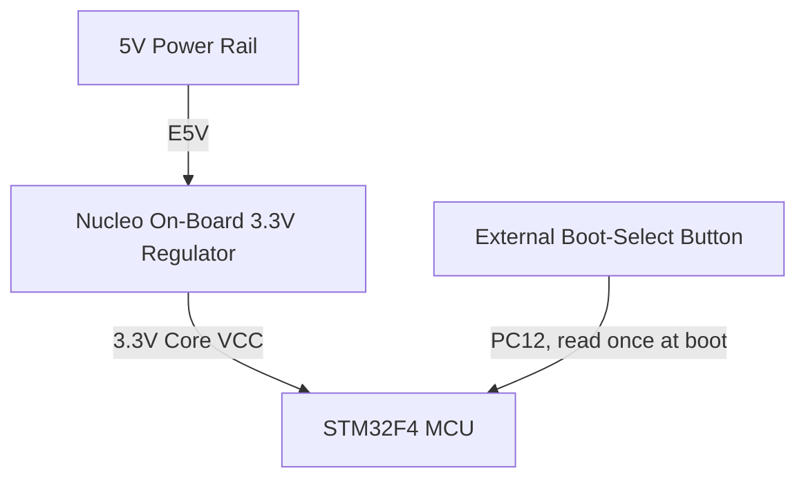

# NUCLEO-F446RE (old board, reference only)

The first ClearAir prototype ran on an STM32F446RE Nucleo-64 board. The project has moved to the WeAct G474CE Long (see the pin plan in the [README](../README.md)). This page keeps the F446RE details for reference.

The F446RE wiring schematic is [`hardware/Nuclio-F466RE/clearair.kicad_sch`](../hardware/Nuclio-F466RE/clearair.kicad_sch) (KiCad 10, every NUCLEO-F446RE morpho pin connection). Do not edit it.

## Board damage note

On this specific STM32F446RE board, the `I2C1` and `I2C2` peripherals are physically damaged ("fried") and unusable. `I2C3` (PA8/PC9) remains the only viable I2C peripheral. `clearair.ioc` was the source of truth for pin allocation; the USART3 link below uses `PB10` (TX) / `PC5` (RX) as allocated there.

## Hardware Peripheral Mapping (STM32F446RE)

| Service | Peripheral | Pin | Notes |
| :--- | :--- | :--- | :--- |
| **SPS30 + BME680** | I2C3                              | PA8 (SCL), PC9 (SDA)            | Standard Open-Drain. |
| **MQ-131 Output** | ADC1_IN0                          | PA0                             | Single-Ended Analog Input (Requires External Divider). |
| **MiCS-4514 (CO)** | ADC2_IN1                          | PA1                             | Single-Ended Analog Input ($V_{OUT1}$). |
| **MiCS-4514 ($NO_2$)** | ADC2_IN7                          | PA7                             | Single-Ended Analog Input ($V_{OUT2}$). |
| **MiCS-4514 (Preheat)** | GPIO Output                       | PC8                             | Push-Pull digital output, driven HIGH during heater warm-up (not PWM). |
| **RobotDyn ZC Input** | EXTI16                            | PC6                             | Digital Input, configured for falling-edge interrupts. The module runs on 5V, so `Z-C` reaches PC6 through a 1.8 kΩ / 3.3 kΩ divider. |
| **RobotDyn Gate Out** | GPIO Output                       | PC7                             | Push-Pull, High-Speed Output driven by Timer ISR. |
| **Phase-Delay Tracking** | TIM3                              | Internal                        | One-Pulse Hardware Mode (Triggered by ZC Interrupt). |
| **OS Kernel Clock** | SysTick                           | Internal                        | Dedicated exclusively to FreeRTOS Scheduler operations. |
| **HAL Timebase** | TIM6                              | Internal                        | Dedicated strictly to standard HAL delay and timeout loops. |
| **Debug & Telemetry** | USART2                            | PA2 (TX), PA3 (RX)              | Asynchronous communication mapped to ST-LINK VCP. |
| **Status Indicator** | GPIO Output                       | PA5                             | Mapped to onboard status LED. |
| **Arduino Visualization Controller (future)** | USART3 (via 2N7000 level shifter) | PB10 (TX), PC5 (RX)             | Future status output stage: an Arduino Nano (5V logic, already in stock) drives an LED array or 7-segment display for per-sensor nominal/fault indication, receiving status bytes over `USART3`; a pair of 2N7000 MOSFETs handle bidirectional 3.3V↔5V level shifting on the TX/RX lines. The safety-latch buzzer remains directly on the STM32, independent of the Arduino. |
| **Manual Reset (external button)** | NRST                              | NRST (exposed on morpho header) | External hardware reset button wired directly to the STM32's `NRST` pin, in parallel with the onboard Nucleo reset button. True hardware system reset; no firmware or GPIO involvement. |
| **Cold/Warm Boot Select (external button)** | GPIO Input                        | PC12                            | External momentary button wired to `PC12`. Firmware reads the pin once at boot: held down means a cold boot, otherwise warm. |

## Power wiring (NUCLEO-F446RE)

- The 5V AC-DC module fed the Nucleo board through `E5V`.
- The 3.3V rail came from the Nucleo board's on-board regulator.
- The MCU ran at 180 MHz (`clearair.ioc`).
- The `I2C3` bus (PA8 SCL, PC9 SDA) used 4.7 kΩ pull-ups to the 3.3V rail, and the USART3 link to the Arduino Nano used `PB10` (TX) / `PC5` (RX).
- The cold/warm boot button was on `PC12`.

## Power budget rows (NUCLEO-F446RE)

These rows replaced the G474 board row in the 5V table. The totals were ~430 mA ≈ 2.2 W typical and ~560 mA ≈ 2.8 W peak, and the 5V module had about 3.5 times margin over the peak.

| Load | Typical | Peak / max |
| :--- | :--- | :--- |
| NUCLEO-F446RE (MCU @ 180 MHz + ST-LINK + LEDs) | ~100 mA | 150 mA |
| 3V3 loads via Nucleo regulator (BME680 incl. gas-heater pulses, I2C pull-ups, 2N7000 pull-ups, PCF8563 RTC) | ~5 mA | 15 mA |

## Block diagram differences

In the README mermaid diagram the F446RE version had these nodes and edges:

